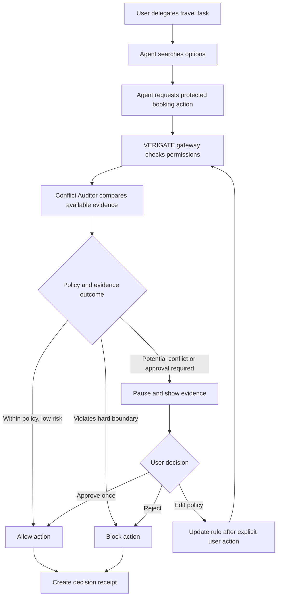
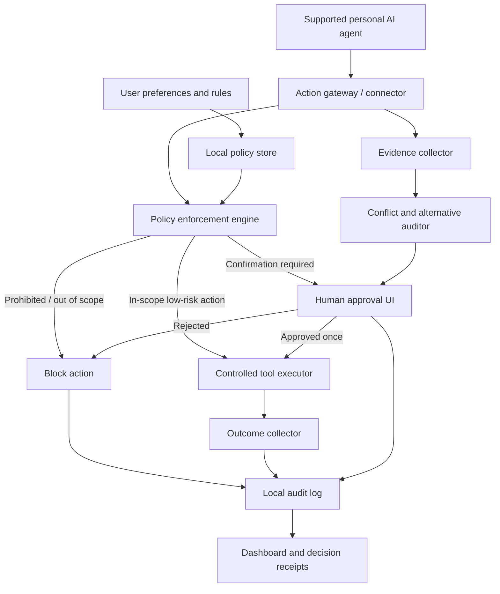

# VERIGATE — Product Context, Feature Specification & Prototype Brief

**Document purpose:** Single source of truth for creating the product prototype and the written solution for the Flipkart APM 2029 case submission.

**Working product name:** VERIGATE  
**Working descriptor:** The Independent AI Accountability Layer  
**Working tagline:** *Verify before AI acts.*  
**Status:** Concept-stage name; trademark, product-name, and domain availability have not been cleared. Previous name research surfaced potentially overlapping uses of “VeriGate” in technology/AI security, so validate the name before public launch. It is acceptable to use as a provisional name while developing the case submission.

---

## 1. Executive summary

By 2040, people may rely on personal AI agents that know their preferences, habits, relationships, finances, health context, and routines, and that can carry out everyday tasks autonomously. These agents may make life faster and easier, but they can also concentrate personal knowledge, persuasive influence, and execution authority in one system.

The central problem is not simply that an AI knows too much. It is that an AI that knows a person deeply may also influence what they see and act on their behalf—potentially without the person understanding the basis for a decision or having a meaningful chance to intervene.

**VERIGATE is a local-first, open-source auditing and enforcement layer that sits between a personal AI agent and the tools or services it can use.** It helps users define what their agents can access, which actions they can take, which choices require human approval, and which actions are prohibited. It also examines available evidence for conflicts between an AI's decisions and the user's stated interests, such as an expensive purchase when a comparable lower-cost option exists alongside a documented commercial incentive.

VERIGATE combines the most useful parts of two concepts:

- **ANCHOR's strengths:** user-controlled permissions, human authority, privacy/memory controls, an emergency pause, action receipts, and preservation of human agency.
- **AI Auditor's strengths:** independent observation of consequential decisions, comparison of alternatives, analysis of disclosed commercial relationships, and evidence-backed reporting of potential conflicts.

The result is not another AI assistant that tells people what is best for them. It is a user-controlled checkpoint that helps ensure personal AI agents act within explicit boundaries and makes their observable decisions easier to inspect.

### Core promise

> **VERIGATE helps people benefit from AI automation without having to surrender control over their data, decisions, or digital lives.**

### One-line product definition

A local-first, open-source control and audit layer that checks protected AI actions against user-defined boundaries, flags evidence-backed conflicts of interest, and returns consequential decisions to the human when needed.

---

## 2. The case problem and the product insight

### Case prompt

“It’s 2040. Everyone has a personal AI agent that knows them better than they know themselves and carries out their day-to-day tasks for them. Outline the ramifications of this paradigm and create a digital product that helps protect yourselves from it.”

The case submission asks the candidate to answer four questions:

1. What problem will the product solve, and why was this problem chosen?
2. Who is the product being built for?
3. What is the product, and how does it solve the identified problem?
4. How will success be measured?

### The key insight

**Predicting what a person is likely to do is not the same as knowing what they want to do—and understanding a person does not automatically give an AI authority to decide for them.**

A personal AI may be helpful and still make a decision that does not reflect the user's current intentions. The AI may optimise for convenience, engagement, a partner service, or an incomplete model of the person. Even where the agent is authorised to act, the user may not have understood the exact action or the incentives around it.

VERIGATE therefore treats user authority, privacy, transparency, and independent evidence as first-class product requirements.

### Ramifications addressed by VERIGATE

- **Loss of practical privacy:** Personal AI systems may combine data from many parts of life and infer sensitive characteristics that were never explicitly shared.
- **Commercial manipulation:** Agent recommendations may be influenced by affiliate relationships, sponsorships, platform incentives, or poorly explained ranking criteria.
- **Unauthorized or excessive action:** An agent may exceed the scope of a task, share information unnecessarily, make an expensive commitment, or act on malicious instructions found in external content.
- **Loss of human agency:** People may become accustomed to allowing AI to make consequential choices, even in areas where they want to preserve their own judgment or skills.
- **Incorrect digital identity:** The AI may turn temporary behaviour into a lasting assumption about the person and then use that assumption to shape future choices.
- **Low transparency and accountability:** Users may struggle to tell what the AI did, which information it accessed, what rule authorised an action, or whether it can be reversed.
- **Security concentration:** One agent may connect to email, calendars, banking, shopping, documents, and home devices. Compromising or manipulating that agent could expose multiple areas of a person's life.

VERIGATE will not claim to solve every societal consequence of AI. It focuses on a practical intervention point: **the boundary between an AI's proposal and its consequential action.**

---

## 3. Target users

### Primary user segment

People who regularly delegate meaningful tasks to personal AI agents and want automation without giving up oversight. Examples include:

- Digitally active consumers using AI to shop, book travel, manage subscriptions, schedule appointments, and communicate.
- Professionals delegating routine administrative work but wanting control over money, sensitive information, commitments, and reputation.
- Users who are concerned about data collection, commercial influence, and opaque AI decisions.
- Privacy-conscious and technically curious users willing to use an open-source tool.

### Initial target for the MVP

**Start with digitally active consumers who delegate shopping or travel research and purchasing.** This segment is useful for the first prototype because the user value is visible: prices and alternatives can be compared, the financial consequence is understandable, and the product can demonstrate a clear sequence of observe → evaluate → ask/block → record.

The initial prototype can use a simulated agent and mock shopping/travel data. A live product would need integrations that allow protected actions to be intercepted reliably.

### User needs

1. Let me automate routine work without granting unlimited permission.
2. Tell me when a consequential action falls outside my rules.
3. Help me understand whether an AI choice is consistent with my preferences and the evidence available.
4. Let me inspect and correct the personal profile an AI uses about me.
5. Show me what happened, why it was allowed, and what evidence supports an alert.
6. Allow me to pause or revoke agent access quickly.
7. Let me verify that the protection product itself is not secretly selling or exploiting my data.

---

## 4. Product principles

These principles should guide the design, implementation, and copy.

### 4.1 Human authority by default

The user defines policy. VERIGATE should not silently substitute its own moral, financial, or lifestyle preferences for the user's stated preferences.

### 4.2 Least privilege

An agent should receive only the minimum data and tool access required for the task, for the shortest practical duration. Access should be scoped by action, resource, purpose, and expiry when the connected system supports it.

### 4.3 Separate advice from execution

An agent may recommend an action that it is not permitted to execute automatically. The permission to advise is not the permission to act.

### 4.4 Evidence before accusation

A price difference is not, by itself, proof of manipulation. VERIGATE separates verified facts, plausible concerns, and unknowns. It should never claim to know hidden motives or private commercial terms that it cannot observe.

### 4.5 Local-first, not magically offline

User policies and sensitive audit records should be local-first wherever practical. Some checks—such as current prices, product availability, ownership disclosures, and booking terms—require external information. Each external source should be identified, timestamped where possible, and handled in a privacy-preserving way.

### 4.6 Open-source transparency

Publish the core source code, policy logic, audit rules, scoring methodology, threat model, and funding disclosures. Use signed releases and, where feasible, reproducible builds and independent security reviews. Open source improves inspectability but does not automatically guarantee safety or independence.

### 4.7 Honest coverage

VERIGATE can only enforce actions that pass through a supported integration or execution gateway. If an agent can use an unrestricted parallel route, the Auditor cannot guarantee interception. Show users what is covered and what is not.

### 4.8 Risk-based interruption

Do not interrupt every routine action. Allow low-risk actions that clearly fit user policy, ask about ambiguous or consequential actions, and block actions that violate a hard rule.

---

## 5. Final feature set

The list below is the recommended core feature set after combining ANCHOR and AI Auditor. It is ordered by importance rather than by implementation dependency.

### Feature 1 — Independent AI Firewall / Action Gateway

**Purpose:** Intercept and govern protected actions before they reach an external service.

**What it does:**
- Receives structured action requests from supported AI agents and tools.
- Checks the request against user rules before execution.
- Allows actions within scope, asks the user for confirmation when required, and blocks prohibited actions.
- Supports emergency pause and per-agent access revocation.
- Records whether an action was intercepted and how it was decided.

**Example:** An AI is authorised to compare flights but not to buy a non-refundable ticket. VERIGATE lets the comparison proceed but blocks the purchase until the user approves.

**Implementation truth:** The gateway must be mandatory for the actions it claims to protect. A browser extension, API connector, scoped credential broker, or sandboxed agent runtime can be used for an initial supported environment. A generic app cannot automatically control every action of every cloud-hosted AI.

### Feature 2 — Personal Authority & Intent Controls

**Purpose:** Let users define the boundary between automation and personal decision-making.

**Core controls:**
- **AUTO:** Permit routine, low-risk actions that fit clearly defined rules.
- **ASK:** Require explicit approval before a specified or consequential action.
- **NEVER:** Prohibit an action or disclosure, even if the agent believes it would be beneficial.

Users can set rules by action type, monetary limit, destination, sensitivity, task scope, and duration where technically supported.

**Examples:**
- “Automatically compare products under my budget.”
- “Ask before any purchase over ₹5,000.”
- “Never share my health data with advertisers.”
- “Draft personal messages, but ask before sending emotionally sensitive messages.”
- “Do not accept or reject job offers for me.”

**Hard boundaries versus preferences:**
- Hard boundaries are constraints the system must enforce, such as a purchase cap or a forbidden disclosure.
- Preferences are priorities to consider, such as price, convenience, environmental impact, or comfort. Preferences may conflict and should not be treated as absolute rules unless the user explicitly makes them so.

### Feature 3 — Corporate Conflict & Decision Auditor

**Purpose:** Inspect evidence around consequential decisions and flag potential conflicts between the user's preferences and the agent's observed choices.

**What it can analyse when evidence is available:**
- Comparable alternatives, total costs, terms, availability, and relevant constraints.
- Disclosed sponsored placements, affiliate links, commissions, and known corporate relationships.
- Candidate options shown to the AI and ranking/recommendation evidence captured by the integration.
- Whether the selected option conflicts with an explicit user rule or appears dominated by a valid alternative.

**Output categories:**
- **Verified fact:** Directly supported by evidence, e.g. a comparable listed fare was ₹140 lower at the recorded time.
- **Potential conflict:** Evidence suggests a commercial incentive or unexplained inconsistency, but the reason is not proven.
- **Unknown / insufficient evidence:** The Auditor cannot inspect the necessary data or terms.

**Important limitation:** The Auditor cannot automatically know which options an AI secretly ignored, what hidden ranking weights it used, or the company's private motives. It can inspect captured candidates and independently reconstruct alternatives when data is accessible. Findings must not turn correlation into an accusation.

### Feature 4 — Personal Memory & Privacy Mirror

**Purpose:** Make the user's digital profile visible and manageable.

Show separate categories:
- Facts the user stated or verified.
- Explicit preferences.
- AI inferences or predictions.
- Outdated or uncertain items.

For an item, show its source or provenance where known, last-updated date, confidence if meaningful, and which connected agent(s) may access it. Let users correct, restrict, expire, or request deletion of information.

**Important limitation:** Deleting an item from VERIGATE cannot erase copies that have already been exported to a third-party system unless that system supports deletion and confirms completion. The UI must communicate what is deleted locally, what deletion requests were sent, and what remains outside the product's control.

### Feature 5 — Intelligent Approval & Intervention

**Purpose:** Present understandable, evidence-backed choices at the right moment.

When the policy or audit engine detects a high-risk, out-of-scope, or potentially conflicted action, show:
- The requested action.
- Why the action was paused or flagged.
- The applicable rule.
- The supporting evidence and its sources.
- Relevant alternatives and differences.
- What happens if the user approves, rejects, or changes the rule.

Available responses should include **Approve once**, **Reject**, and **Edit rule**. A prohibited action must not be overridable merely because the AI says it is useful; the user should have to explicitly change their policy if that is permitted by the product's policy design.

### Feature 6 — Transparent Audit Trail & Dashboard

**Purpose:** Let users inspect outcomes and understand how much of their activity is actually protected.

The dashboard should show:
- Protected actions observed.
- Actions allowed, paused, and blocked.
- Rules that authorised or rejected an action.
- Audit findings and their evidence status.
- Uninspected actions or gaps in integration coverage.
- Available financial savings, distinguishing actual savings from estimated or potential savings.

Avoid a single unexplained “Trust Score”. If a summary score is later introduced, publish the formula and display coverage, confidence, and limitations alongside it. Passing every observed check does not prove that an AI is generally trustworthy.

Every consequential action should have a **Decision Receipt** with action, time, requested scope, accessed data, applicable rule, tool/service, decision, user approval status, outcome, and reversibility if known.

### Feature 7 — Open-Source Trust Framework

**Purpose:** Make it possible for users and independent reviewers to evaluate VERIGATE itself.

Recommended commitments:
- Publish the core enforcement code and audit rules under a suitable open-source license.
- Publish the threat model, data flows, known limitations, and test cases.
- Disclose funding, sponsorships, material conflicts of interest, and governance arrangements.
- Use signed releases and, where feasible, reproducible builds.
- Encourage independent security reviews and a public vulnerability-reporting process.
- Keep telemetry off by default or make it explicit and optional.
- Avoid advertising based on user profiles, and never sell the personal data or behavioural vulnerabilities the product is meant to protect.

**Trust principle:** Open source is an essential mechanism for scrutiny, not a guarantee that the installed software or its maintainers can never be compromised.

---

## 6. Deferred / later features

These features can be shown as roadmap ideas but should not overload the MVP.

### Behavioral Pattern Auditor

Identify observable patterns that conflict with user preferences, such as repeated engagement prompts during a protected sleep window, repeated recommendations for explicitly unwanted content, or repeated attempts to steer a user after a refusal. Do not claim to measure dopamine or infer a user's mental baseline from ordinary app logs.

### Weekly Accountability Report

Summarise actions reviewed, prohibited actions blocked, potential conflicts, verified savings, unresolved issues, and uninspected activity. Clearly separate actual outcomes from estimates.

### Consumer Redress Assistant

Prepare evidence-backed refund requests or consumer complaints for user review. Avoid promising automatic lawsuits or asserting that every questionable recommendation constitutes a legal violation. Requirements vary by jurisdiction and case.

### Human Agency Mode

For user-selected areas—learning, career choices, finance, writing, or relationships—the assistant can provide options and reasoning rather than execute the final choice. The feature is user-directed; VERIGATE should not force manual work or decide which skills a person must preserve.

### Broader integration ecosystem

Expand to additional agent runtimes, email, calendars, shopping, travel, banking-related actions, smart home, and work tools only where the relevant platforms support reliable enforcement and the security model has been reviewed.

---

## 7. Primary user journey for the prototype

**Recommended demonstration scenario: an AI shopping or travel agent selects a more expensive option while a comparable alternative exists.** It shows both the enforcement and independent auditing value without trying to represent every use case.

### Scenario

The user tells their AI: “Find me a suitable flight and book it within my budget.” The AI proposes a flight for ₹37,500. VERIGATE's connected comparison service finds a flight for ₹26,000 with the same route and dates and a comparable schedule. The selected booking is on a platform with a known commercial relationship, but the evidence does not prove that the relationship caused the selection.

These prices are illustrative; a prototype should label them as sample data.

### Flow

### What the user should see

1. The agent's selected option, price, and stated rationale if captured.
2. A comparable alternative with important differences clearly shown.
3. Any known commercial relationship and source of that evidence.
4. A clear distinction between verified price difference and unproven motive.
5. Choices to approve once, reject, or edit the policy.
6. A receipt after the user acts, including what was allowed or blocked.

### Why this journey is ideal

- The problem is immediately understandable.
- The financial trade-off is concrete.
- The Auditor can demonstrate both a useful comparison and the limits of what it can infer.
- It can be implemented visually with sample data.
- It shows the full cycle: delegated task, intercepted action, evidence, human choice, and accountability record.

---

## 8. Prototype specification: screens and interactions

The case brief allows either a walkthrough video showing active use of a prototype or a ZIP containing runnable HTML/CSS/JS files. Static slides or an album of mock-up screenshots are not sufficient as the only prototype submission. The prototype is a visual representation; it is not expected to provide production-grade security enforcement.

### Screen 1 — Dashboard / Home

**Purpose:** Provide a quick view of what VERIGATE is doing and what needs the user's attention.

**Elements:**
- Product logo/name and compact navigation.
- Protection status for the connected demo agent.
- Coverage label, e.g. “Protected actions through this demo gateway” (not “all AI activity protected”).
- Cards for actions reviewed, paused, blocked, and potential conflicts.
- Pending approvals list.
- Recent activity timeline.
- Emergency pause control.

**Interactions:**
- Clicking a pending approval opens the review screen.
- Clicking an event opens the receipt.
- Pause disables the simulated agent's ability to perform protected actions and changes the UI to a paused state.
- A resume action restores the simulated flow after confirmation.

### Screen 2 — Agent & Permission Settings

**Purpose:** Demonstrate user control over delegated authority.

**Elements:**
- Connected agent name/status.
- AUTO / ASK / NEVER control per action category.
- Example categories: search and compare, purchase, share personal data, send message, accept commitment.
- Monetary threshold field for purchases.
- Allowed data scope and permission expiry.
- Revoke access button.

**Interactions:**
- Changing a rule updates the simulated policy store/UI.
- A later action is evaluated against the updated rule.
- Revocation prevents subsequent protected actions in the prototype.

### Screen 3 — Audit Alert / Approval Detail

**Purpose:** Show why an action was intercepted and let the user decide.

**Elements:**
- Alert heading such as “Price discrepancy detected”.
- Selected option and alternative comparison.
- Total price and relevant terms.
- Evidence cards: verified fact, potential conflict, unknown.
- Source and timestamp labels for sample evidence.
- A plain-language explanation of the applicable rule.
- Buttons: **Approve once**, **Reject**, **Edit rule**.

**Interactions:**
- Approve once allows the simulated action and records that approval.
- Reject blocks the action and records the decision.
- Edit rule opens a small form and requires the user to save the changed rule explicitly.
- The app must not display a claim like “corporate manipulation confirmed” unless the demo data truly supports it.

### Screen 4 — Memory & Privacy Mirror

**Purpose:** Demonstrate personal data visibility and control.

**Elements:**
- Tabs or filters: Facts, Preferences, AI Inferences, Outdated.
- Memory cards with item, source, last updated, use permissions, and confidence/uncertainty where meaningful.
- Actions to correct, restrict, expire, or delete locally.
- Clear notice that deleting local memory cannot guarantee erasure from a third-party model or database.

**Interactions:**
- Edit changes the item in the prototype data store.
- Restrict changes its visibility/use permission.
- Delete removes it from the demo store and adds an audit event.

### Screen 5 — Activity / Decision Receipt

**Purpose:** Demonstrate transparency and accountability.

**Elements:**
- Chronological event list with allowed, paused, and blocked status.
- Filters for date, agent, action category, and status.
- Receipt details: requested action, data accessed, active rule, tool/service, decision, approval source, outcome, reversibility if known.
- “Why was this allowed/blocked?” explanation linked to the exact rule.

**Interactions:**
- Clicking an event opens its receipt.
- Filters change the displayed data.
- A sample receipt can be copied or downloaded if that is included in the implementation.

### Screen 6 — Open-source & Trust page (can be a section rather than full screen)

**Purpose:** Make the governance promise visible instead of relying on a badge.

**Elements:**
- Link/button to source repository (placeholder in prototype if not yet created).
- Privacy principles.
- Funding and governance disclosures (clearly label these as proposed if not yet real).
- Build verification/security review roadmap.
- Coverage limitations and known issues.

**Important:** Do not present proposed governance or implemented security controls as already operational. Label roadmap items honestly.

---

## 9. Information architecture

Recommended navigation for the prototype:

- **Home** — status, findings, approvals, pause control.
- **Approvals** — decisions awaiting human input.
- **Agents & Rules** — connected agents, AUTO/ASK/NEVER policies, permissions.
- **Memory** — visible personal facts, preferences, inferences, and controls.
- **Activity** — audit log and decision receipts.
- **About / Open Source** — project principles, governance, and coverage.

For a small prototype, Home, Approvals, Rules, Memory, and Activity are sufficient. The Open Source section can be a footer or settings page.

---

## 10. Technical architecture (conceptual)

VERIGATE should have three distinct functions: policy enforcement, independent auditing, and evidence logging. These functions can share a local application but should have clear responsibilities and failure boundaries.

### Component responsibilities

| Component | Responsibility |
|---|---|
| Local policy store | Stores user rules, preference priorities, scope, and expiry. |
| Action gateway / connector | Receives protected requests from supported agents and mediates access to connected tools. |
| Policy enforcement engine | Applies deterministic allow/ask/block rules before protected execution. |
| Evidence collector | Captures available options, action payloads, price/terms, data access, source, and timestamp. |
| Conflict and alternative auditor | Compares available evidence and identifies rule conflicts, potential commercial conflicts, or missing data. |
| Human approval UI | Presents the issue and records the user decision. |
| Controlled tool executor | Performs allowed operations using scoped credentials when the integration supports them. |
| Local audit log | Stores decision receipts and outcomes with integrity protections appropriate to the implementation. |
| Dashboard | Makes current status, findings, coverage gaps, and history understandable. |

### Architecture rules

- The agent must not retain unrestricted credentials that allow it to bypass the gateway for actions claimed to be protected.
- Use least-privilege or short-lived credentials when connected services support them.
- Enforce hard constraints with deterministic code wherever possible; do not rely solely on another language model to decide whether the first model is safe.
- High-impact operations should be denied or paused when the required policy check is unavailable, according to the user's chosen risk policy.
- Store only data needed for policy decisions and audit evidence. Use encryption and minimal logs.
- Record source and timestamp for external evidence; stale data should be labelled.
- The audit log should not pretend to reveal hidden chain-of-thought or private internal model reasoning. It can record provided rationales, visible candidates, tool calls, policy results, and outcomes.
- Local-first architecture reduces some exposure but does not remove risks from compromised devices, malicious updates, unsafe integrations, or data that leaves the device.

### Indicative implementation stack (not fixed)

For a working web prototype: HTML/CSS/JavaScript or React for the UI; a small local/demo API or browser local storage for sample state; structured JSON data for agents, permissions, alternatives, alerts, and receipts. For a later functional pilot, a backend such as Python/FastAPI and a database such as SQLite/PostgreSQL could be considered, alongside supported tool connectors and a scoped credential system.

The case prototype can be front-end-only with sample data. Do not imply it provides real OS-level interception unless that is actually implemented.

---

## 11. Trust model, threat model, and limitations

### Threats VERIGATE aims to mitigate

- An AI attempts an action outside the user's explicit scope.
- A tool request includes unnecessary or sensitive data.
- An AI attempts to send data to an unexpected destination.
- A purchase or recommendation is inconsistent with a hard rule or has a potentially relevant commercial conflict.
- External content attempts to redirect the AI away from the user's task.
- The user cannot reconstruct what permission authorised a past action.
- An agent continues to operate after the user wants to revoke access, within integrations controlled by VERIGATE.

### Threats not automatically solved

- Actions performed outside integrations or through credentials the AI can use directly.
- Hidden incentives or private commercial contracts for which there is no observable evidence.
- Inaccurate, malicious, or outdated third-party price/ownership data.
- A compromised host operating system, malicious product update, or compromised maintainer account.
- Information already copied into an external service that does not honour deletion requests.
- Poor choices that technically comply with the user's permissions and preferences.
- Legal outcomes or proof of unlawful manipulation.

### Governance safeguards

- Open-source core and transparent policy rules.
- Public threat model and clearly documented limitations.
- Multiple maintainers and a transparent release process.
- Signed releases; reproducible builds where feasible.
- Independent security reviews and responsible vulnerability disclosure.
- Funding/affiliate disclosures and no sale of personal user profiles.
- User-controlled retention and optional telemetry.
- Separation between commercial sponsors and enforcement decisions.

---

## 12. Success metrics and evaluation plan

The product should be evaluated for safety, utility, and user comprehension—not just the number of alerts it generates.

| Metric | Definition / how to measure |
|---|---|
| Prohibited-action blocking rate | Fraction of known prohibited test actions blocked before execution in the supported environment. |
| False-block rate | Fraction of legitimate, in-policy test actions unnecessarily blocked. |
| Approval burden | Average number of prompts per completed user task and percentage of prompts judged unnecessary. |
| Protected-action coverage | Fraction of in-scope actions that actually pass through the gateway, with gaps disclosed. |
| Receipt completeness | Fraction of consequential actions with the required action, rule, decision, evidence, and outcome fields. |
| Conflict finding precision | Fraction of flagged conflicts that reviewers judge supported by the available evidence. |
| Verified savings | Amount actually saved after a user selects an alternative, excluding hypothetical savings. |
| User comprehension | Whether users can correctly explain what the AI was allowed to do and why an action was paused. |
| Time to revoke | Time and steps required to revoke a connected agent's access in the supported integration. |
| Memory correction effectiveness | Whether corrections affect the locally controlled profile and supported downstream integrations, with external limitations shown. |

### Suggested test design

Create a controlled evaluation set with examples of allowed, prohibited, ambiguous, and potentially conflicted actions. For example, test 100 intended actions and 20 prohibited actions, then report how many valid actions complete, how many prohibited actions are blocked, and how often the system asks unnecessarily. This is a proposed test design, not a claim of achieved performance.

For the prototype walkthrough, show at least three cases:

1. A routine low-risk action is allowed.
2. An action violating a clear user rule is blocked.
3. An expensive selection with a comparable alternative and a disclosed commercial relationship is paused for review, with uncertainty represented honestly.

---

## 13. MVP scope and roadmap

### MVP: demonstrate the core promise

Build only enough to prove that a user can delegate a task while retaining enforceable boundaries and visibility.

**MVP includes:**
- One simulated personal AI agent.
- One protected task category: shopping or travel booking.
- AUTO / ASK / NEVER policy controls.
- A simulated action gateway that routes every in-scope action through a policy check.
- A price/alternative comparison with sample data.
- A conflict alert that distinguishes verified fact, potential conflict, and unknown.
- Approve once / reject / edit rule interaction.
- A local/demo audit trail and decision receipt.
- Emergency pause/revoke interaction.
- A compact Home dashboard.

**MVP does not need:**
- Real financial account integration.
- Universal OS-level interception.
- Live connections to every AI agent.
- Real-time detection of private model incentives.
- Automated lawsuits or legally binding actions.
- A single numerical trust score.
- A clinical claim about dopamine, mental health, or a user's psychological baseline.

### Phase 2: widen control and visibility

- Memory & Privacy Mirror.
- More integration types.
- More mature external evidence and corporate relationship sources.
- Better audit history search and export.
- Coverage indicators and integration health.

### Phase 3: deeper consumer and agency protections

- Behavioral pattern auditing against user-defined preferences.
- Weekly accountability report.
- Consumer redress preparation.
- Human Agency Mode.
- Independent audits and broader open-source contributor governance.

---

## 14. Product positioning and messaging

### Product name

**VERIGATE** is the current working name. It is intended to suggest “verify” plus “gate”: examine an action and control whether it can proceed. The name has not been legally cleared and may overlap with existing technology products; conduct relevant trademark, domain, and product-name checks before public use.

### Working descriptor

**The Independent AI Accountability Layer**

### Working tagline

**Verify before AI acts.**

### Alternate tagline options

- Your AI. Your rules. Your control.
- Intelligence with boundaries.
- Keep AI accountable to you.
- Let AI assist. Keep your authority.

### Elevator pitch

By 2040, personal AI agents may know our habits, preferences, and vulnerabilities and act on our behalf. That convenience creates a risk: a system can understand us deeply while making decisions that exceed our wishes or serve incentives we cannot see. VERIGATE is a local-first, open-source control and audit layer that enforces user-defined boundaries, independently examines observable evidence around consequential decisions, flags potential conflicts, and records why actions were allowed or blocked. It lets people automate routine tasks without giving up control over their data or important choices.

### Messaging guardrails

Say:
- “Flags potential conflicts supported by available evidence.”
- “Enforces policies for supported, mediated actions.”
- “Shows protection coverage and known limitations.”
- “Helps users inspect and control their locally managed profile.”

Do not say:
- “Guarantees the AI always acts in your best interest.”
- “Detects every hidden corporate motive.”
- “Protects every action across every app.”
- “Proves manipulation from a price difference alone.”
- “Deletes your information from every third party” without verified support.

---

## 15. Translating this product into the 2-page case solution

The written case response has a strict maximum of 1,200 words, a body limit of two A4 portrait pages, body font size 10–13 px, and must be submitted as PDF. The template requests the candidate's full name, institute/enrolment number, email, and phone on the cover. The case brief asks the candidate to answer the four leading questions listed in Section 2. References or primary research may be placed in up to two additional appendix pages if used. Check the official task brief for the exact current submission instructions and filename requirements.

### Suggested two-page narrative

**Page 1 — Problem and insight**
- Establish the 2040 scenario.
- Summarise the major ramifications, but focus on one core problem: personal AI agents have concentrated knowledge, influence, and execution authority without transparent, enforceable user boundaries.
- Explain the target user and initial use case.
- State the product insight: prediction is not consent; permission to help is not unlimited permission to act.

**Page 2 — Solution and validation**
- Introduce VERIGATE and explain the gateway/policy/auditor combination.
- Highlight the 4–5 most essential features rather than listing every roadmap idea.
- Show a tiny user journey or architecture diagram.
- Define two to four measurable success indicators.
- Note open-source governance and the limitation that only integrated/mediated actions can be enforced.

### Recommended features to highlight in the written submission

1. Independent AI Firewall.
2. Personal Authority Controls (AUTO / ASK / NEVER).
3. Corporate Conflict & Decision Auditor.
4. Intelligent Approval with evidence.
5. Transparent Decision Receipts and protection coverage.

Memory & Privacy Mirror and the Open-Source Trust Framework are important supporting elements; include them if space permits.

---

## 16. Checklist for building the prototype

### Before design
- [ ] Confirm working product name and create a simple wordmark.
- [ ] Choose the single demo scenario (shopping or travel; travel is particularly visual).
- [ ] Define the sample agent, user rules, options, evidence, and action outcomes.
- [ ] Decide which actions are allowed, paused, or blocked in the demo.
- [ ] Mark all simulated data as illustrative.

### Build screens
- [ ] Home dashboard with status, coverage, findings, approvals, and pause.
- [ ] Agent/rules screen with AUTO / ASK / NEVER.
- [ ] Alert detail showing selected option, alternative, evidence, uncertainty, and choices.
- [ ] Activity/decision receipt screen.
- [ ] Optional memory screen if time permits.
- [ ] Optional Open Source/trust section.

### Implement interactions
- [ ] Navigation works between screens.
- [ ] Alert buttons produce different outcomes.
- [ ] Approve records an allowed action and generates a receipt.
- [ ] Reject blocks the action and generates a receipt.
- [ ] Editing a rule changes the policy used by the next simulated action.
- [ ] Pause blocks the next protected demo action; resume requires a deliberate user interaction.
- [ ] Memory edit/delete changes the local prototype state if memory is included.
- [ ] Activity filters or receipt links work if included.

### Final validation
- [ ] The prototype demonstrates active interaction, not just static mock-ups.
- [ ] The same features and flow are described in the 2-page proposal.
- [ ] The UI distinguishes facts, concerns, and unknowns.
- [ ] Coverage limitations are visible.
- [ ] No fake claim is made that sample data is live or a mock-up blocks real OS actions.
- [ ] The prototype can be run using the submitted HTML/CSS/JS ZIP, or a walkthrough video shows a person using it.

---

## 17. Final recommendation

Position VERIGATE as **an independent accountability layer, not just a privacy dashboard or an AI safety chatbot**.

Its distinctive value is the combination of:

1. **Prevention:** It enforces boundaries on supported protected actions before execution.
2. **Independent review:** It examines available evidence for conflicts with user preferences and known commercial incentives.
3. **Human authority:** It returns consequential or ambiguous decisions to the user.
4. **Accountability:** It creates receipts showing what happened and which rule or evidence shaped the outcome.
5. **Verifiability:** Its open-source core and transparent governance enable independent scrutiny.

The prototype should demonstrate those five ideas through one clear scenario. The case solution should then explain why that intervention is both useful and technically credible, while being honest about evidence gaps, platform integration limits, and open-source governance risks.

**Core thesis to preserve throughout the project:**

> The future should let AI understand us deeply without allowing that understanding to become unchecked authority over our lives.
